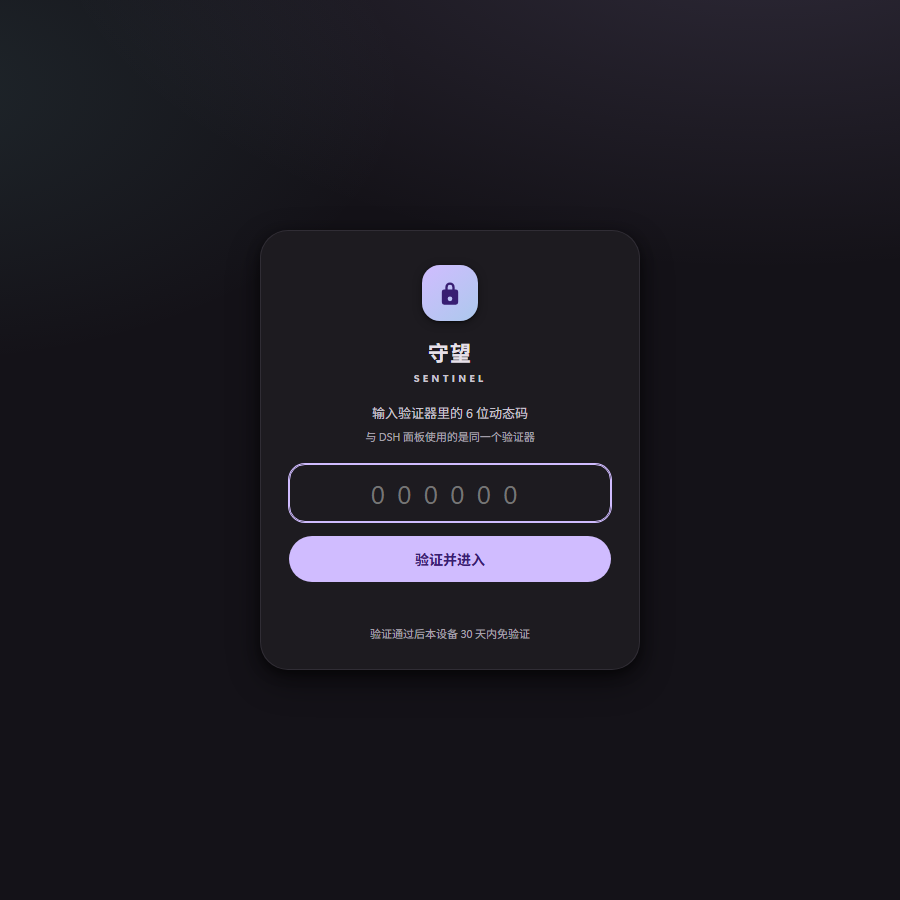

# Watch Sentinel · 守望

> 手机离家、人不在电脑前，才让摄像头替你看着。
> 画面有异动 → Telegram 告警；认出人形 → 连拍挑最清晰的几张，作为**一条相册**发到你的 TG。



一个跑在 Windows 本机的小哨兵：

- **蓝牙门禁**：手机（可指定任意已配对设备）还连着电脑 → 待机，不打扰。
- **在场门禁**：屏幕亮度不是最低、且 Windows 没锁屏 → 认为你还在电脑前，待机。
- **帧差检测**：和几秒前的画面比，变化像素超过阈值 → 发文字警报。
- **人形检测**：YuNet 人脸 / 运动大块（人形轮廓）/ 运动速度，任一命中 → **连拍 N 张，按清晰度取最好的 m 张**，作为一条带文字的相册发出。
- **Material Design 3 面板**：所有开关与阈值都能在网页上改，`tailnet`/局域网可访问，可选 TOTP 登录。
- 纯 CPU：640×480 单帧分析约 **8–20 ms**，不用 GPU、不用 YOLO/torch。

---

## 它是怎么工作的

```
            ┌──────────────┐     手机连着 → 待机
  蓝牙配对表 │ Bluetooth    │
            └──────┬───────┘
                   │ 断开
            ┌──────▼───────┐     屏幕亮 + 未锁屏 → 待机
  亮度/锁屏  │ Presence     │
            └──────┬───────┘
                   │ 电脑不在用
            ┌──────▼───────┐
  摄像头帧  │ 帧差 + YuNet │── 变化超阈值 → TG 文字
            └──────┬───────┘
                   │ 人脸 / 人形 / 速度命中
            ┌──────▼───────┐
            │ 连拍 N 张     │ 按 Laplacian 方差挑最清晰 m 张
            └──────┬───────┘
                   ▼
        Telegram sendMediaGroup（一条相册，首图带 caption）
```

判据细节：

| 判据 | 默认 | 说明 |
|---|---|---|
| 画面变化 | ≥ 2% 像素 | 与 `compare_seconds`（默认 5 s）前比，单像素灰度差 > 25 才算"变了" |
| 运动速度 | ≥ 12 %/s | 相邻两拍的差异比例 / 时间 |
| 人脸 | 置信度 ≥ 0.80、≥ 48 px | OpenCV YuNet（`FaceDetectorYN`） |
| 人形轮廓 | 最大运动块 ≥ 8% 面积、高宽比 ≥ 1.05 | 帧差 + 形态学 + 轮廓 |
| 冷却 | 60 s | 同类告警不重复；两类之间至少 8 s |

**清晰度**用 Laplacian 方差：`cv2.Laplacian(gray, CV_64F).var()`，对运动模糊/失焦最敏感，单张 < 3 ms，不需要模型。

---

## 环境要求

- **Windows 10/11**（蓝牙、WMI 亮度、锁屏检测都用了 Win32 API）
- Python **3.10+**（开发环境 3.14）
- 一个摄像头（笔记本内置即可）
- 蓝牙适配器（手机需先与电脑配对）
- 可选：Telegram Bot（告警通道）、TOTP 验证器（登录保护）

依赖：`opencv-python-headless`、`numpy`、`requests`、`starlette`、`uvicorn`、`pywin32`。

---

## 快速开始（手动）

```powershell
git clone https://github.com/fengye1003/watch-sentinel.git
cd watch-sentinel
python -m pip install -r requirements.txt
python scripts\fetch_model.py      # 下载 YuNet 模型（约 230 KB，未入库）
```

### 1. 配 Telegram（可选，但强烈建议）

1. 找 @BotFather 建一个 bot，拿 token；
2. 存到 `%USERPROFILE%\.watch-sentinel\token.txt`（只放 token 一行）；
3. 给 bot 发一条消息，然后：

```powershell
curl "https://api.telegram.org/bot<你的TOKEN>/getUpdates"
```

从返回里找 `message.chat.id`，填到面板的 **Chat ID**（或 `data/config.json` 的 `notify.chat_id`）。
Telegram 需要代理时，面板里填 `http://127.0.0.1:7897`（默认值），失败会自动尝试直连。

### 2. 启动

```powershell
.\start.ps1          # 后台启动，隐藏窗口
# 或者前台调试：
python app.py
```

打开 <http://127.0.0.1:8099/>。第一次启动会在 `data/` 下生成 `config.json`。

### 3. 面板里设置

- **目标设备名**：填你手机在蓝牙里的名字（点设备列表里那一行即可）；名字里的 `.`、`·`、空格、`-` 会被忽略，`Pixel.hello` 与 `Pixel·hello` 都能匹配。
- **电脑在用时不报警**：默认开；屏幕调到最低或锁屏时才会放行。
- **检测阈值 / 连拍**：按现场噪声调。
- **测试**：`测试` 发一条联通消息；`模拟告警` 用当前画面走完整链路（带相册）；`演练 10s` 只测识别、不发 TG。

### 4. 可选：TOTP 登录保护

```powershell
# 生成一个 Base32 secret（或直接复用你已有的验证器）
python -c "import secrets,base64; print(base64.b32encode(secrets.token_bytes(20)).decode())"
```

把结果存成 `%USERPROFILE%\.watch-sentinel\totp.json`：

```json
{ "secret": "你的BASE32密钥" }
```

然后 `data/config.json`：

```json
"auth": { "enabled": true, "secret_file": "~/.watch-sentinel/totp.json", "session_days": 30 }
```

重启后打开面板 → `/login` → 输入验证器里的 6 位码（RFC 6238 / SHA-1 / 30 s）。
也可以把 `secret_file` 指向别的程序的状态文件（例如 DSH Web 面板的 `~/.dsh/auth/state.json`），复用同一个验证器条目。

### 5. 开机自启

```powershell
.\install-autostart.ps1     # 注册 SentinelWatch（登录自启）+ SentinelWatchdog（每 5 分钟兜底）
.\uninstall-autostart.ps1   # 取消
```

自启任务通过 `wscript.exe` + `watchdog-hidden.vbs` 启动，**不会闪控制台窗口**（任务计划程序直接拉 `powershell -WindowStyle Hidden` 会先建窗再隐藏，必然闪一下）。

---

## 给 AI Agent 的快速部署

仓库里附了一份给 agent 照着执行的 runbook：[docs/DEPLOY-FOR-AGENTS.md](docs/DEPLOY-FOR-AGENTS.md)。
它包含：环境自检、装依赖、下模型、写配置、启动、用 API 验收、以及 6 个会伪装成"程序坏了"的坑。

最短路径：

```powershell
git clone https://github.com/fengye1003/watch-sentinel.git
cd watch-sentinel
python -m pip install -r requirements.txt
python scripts\fetch_model.py
python app.py
# 健康检查
curl http://127.0.0.1:8099/api/health
```

---

## 配置（data/config.json）

| 段 | 键 | 默认 | 含义 |
|---|---|---|---|
| `armed` | | `false` | 哨兵总开关 |
| `bt` | `target_name` | `My Phone` | 目标手机名（归一化匹配） |
| | `require_disconnected` | `true` | 手机连接时待机 |
| `presence` | `enabled` | `true` | 电脑在用时不报警 |
| | `brightness_tolerance` | `0` | 亮度容差（0–50） |
| `burst` | `interval_ms` / `count` / `keep` | `150 / 6 / 3` | 连拍间隔、张数、发送张数 |
| `camera` | `index/backend/fps` | `0/dshow/15` | 采集参数（`msmf` 可回退） |
| `detect` | `compare_seconds` | `5` | 与几秒前对比 |
| | `change_ratio` / `pixel_diff` | `0.02 / 25` | 变化阈值 |
| | `motion_speed` | `12` | 速度阈值 %/s |
| | `face_score` / `face_min_size` | `0.80 / 48` | 人脸 |
| | `body_ratio` | `0.08` | 人形轮廓 |
| | `cooldown_seconds` | `60` | 冷却 |
| `notify` | `chat_id` | 空 | TG 私聊 id |
| | `token_file` | `~/.watch-sentinel/token.txt` | Bot token |
| | `proxy` | `http://127.0.0.1:7897` | 代理，失败自动直连 |
| `api` | `host/port` | `0.0.0.0/8099` | 监听 |
| `auth` | `enabled` | `false` | TOTP |
| `storage` | `keep_snapshots` | `200` | 截图保留数 |

面板改配置即时生效（`PATCH /api/config`）。

---

## HTTP API

| 方法 | 路径 | 作用 |
|---|---|---|
| GET | `/api/state` | 完整状态（门禁/蓝牙/亮度/指标/事件/配置） |
| GET/PATCH | `/api/config` | 读 / 深合并改配置 |
| POST | `/api/arm` | `{"armed":true}` |
| POST | `/api/bt/refresh` | 立即重读蓝牙 |
| POST | `/api/presence/refresh` | 立即重读亮度/锁屏 |
| POST | `/api/drill` | `{"seconds":10}` 演练：只测识别、不发 TG |
| POST | `/api/telegram/test` | 联通性测试 |
| POST | `/api/telegram/simulate` | 模拟一次完整告警（带相册） |
| GET | `/api/snapshot.jpg` | 当前帧（带标注） |
| GET | `/api/events` | 事件 |
| POST | `/api/auth/login` | `{"code":"123456"}` 换 cookie |
| GET | `/api/health` | 健康检查（免登录） |

---

## 设计取舍 / 已知坑

1. **蓝牙连接状态不能看 `Get-PnpDevice` 的 Status**：配对了但没连的设备也会显示 `OK`。必须走 Win32 `BluetoothGetDeviceInfo().fConnected`（`core/bt.py` 用 ctypes 直调 `bthprops.cpl`）。
2. **OpenCV 读模型不吃中文路径**：路径含中文时报 `Can't read ONNX file`，看起来像模型坏了。`detector.ascii_model_path()` 会把模型复制到 `%LOCALAPPDATA%\sentinel\models\` 再加载。
3. **OpenCV 5 移除了 `CascadeClassifier` / `HOGDescriptor`**：所以不用 Haar，走 `FaceDetectorYN`。
4. **亮度别用 dxva2**：部分 HDR 屏 `GetMonitorBrightness` 直接返回 `ERROR_GEN_FAILURE`，WMI `WmiMonitorBrightness` 才稳；WMI 的 COM 对象有线程亲和，跨线程会报"已为另一线程整理的接口"。
5. **摄像头后端**：`MSMF` 偶发"能打开但读不到帧"，默认 `DSHOW`，失败自动回退。
6. **连拍会短暂阻塞检测循环**：总时长封顶 8 s，默认 0.9 s。
7. **相册限制**：Telegram `sendMediaGroup` 需要 2–10 张，1 张自动降级 `sendPhoto`；caption 只能挂在第一张。

---

## 安全与隐私

- 默认监听 `0.0.0.0:8099`。放到 tailnet/局域网前，建议打开 **TOTP** 或设置 `api.token`。
- `data/`（配置、事件、截图、`session.key`）和 `models/*.onnx` 都在 `.gitignore` 里，不会被提交。
- 截图会包含真实画面，落盘位置可在 `storage.snapshot_dir` 调整。
- Telegram token 只从 `notify.token_file` 读取，不写进配置。

---

## License

MIT。见 [LICENSE](LICENSE)。

## Authors

- **星澄（Hoshino Sumi）** — 设计、实现、文档
- **幻愿** — 需求、产品定义、验收

> 摄像头不会替你判断"该不该看"，它只负责在你不在的时候，把看见的东西留在你能看到的地方。
